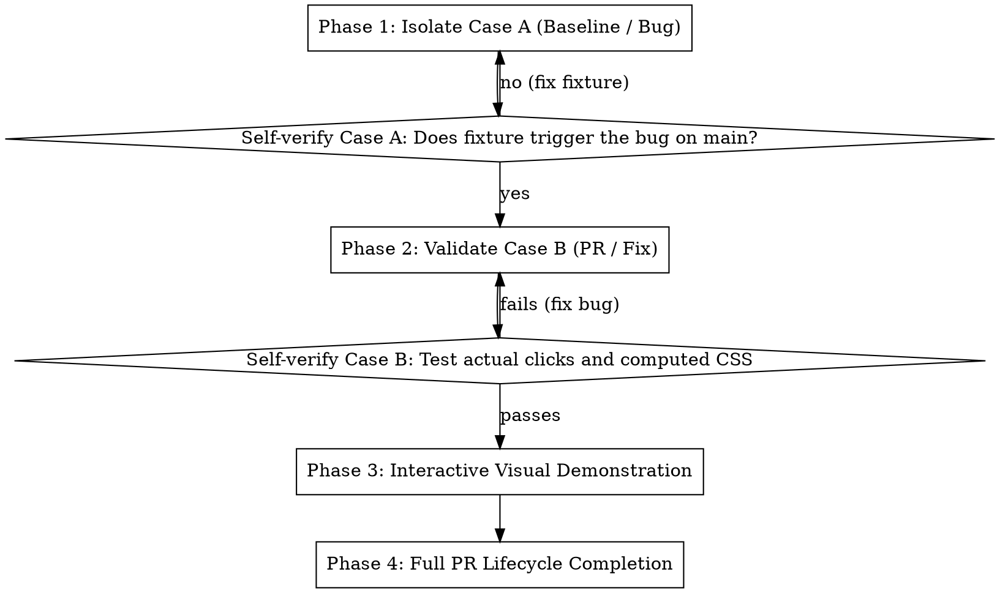

# Reproducing & Verifying PRs Comparatively

## Overview

A pull request claim is only as good as its verification. Simply reading the diff or running unit tests often misses interaction bugs, CSS cascading overrides, or broken workflows.

**Core Principle:** Every PR verification requires **comparative proof**:
1. **Case A (With Error):** Reproduce the bug on the base branch (`main`).
2. **Case B (Without Error):** Demonstrate the bug is resolved on the PR branch using the exact same fixture, with zero side-effects.

Never declare a PR verified without demonstrating both states side-by-side.

---

## The 4-Phase Protocol



---

### Phase 1: Isolate Case A (Baseline / Bug on `main`)

1. **Check out the base branch (`main`):**
   ```bash
   git checkout main
   npm run build
   ```
2. **Formulate the minimal reproduction fixture:**
   - Craft the smallest possible test data (e.g. trace JSON, payload, or DOM tree) that triggers the issue.
   - Strip away unrelated nodes or operations to isolate the variable under test.
3. **MANDATORY GATE — Self-Verify the Fixture:**
   - Run the reproduction on `main` and confirm the bug occurs:
     - Is the error thrown?
     - Does the unexpected UI state appear?
     - Does the hit-test or click fail?
   - **Hard Rule:** If the fixture produces normal/expected output on `main`, STOP. The fixture is flawed (e.g., misconfigured topology or missing attributes). Fix the fixture before touching the PR branch.

---

### Phase 2: Validate Case B (PR Branch / Fix)

1. **Check out and build the PR branch:**
   ```bash
   git checkout <pr-branch>
   npm run build
   ```
2. **Execute the identical scenario from Phase 1:**
   - Feed the exact same fixture to the PR build.
3. **MANDATORY GATE — Interactive & Visual Verification:**
   - Do **NOT** rely solely on unit tests or shallow DOM attributes.
   - **Click & Event Testing:** Test whether elements can actually be clicked, hovered, or dragged. Check `pointer-events`, z-index stacking, and Shadow DOM event boundary retargeting.
   - **Computed CSS Inspection:** Check computed styles. For example, setting `element.hidden = true` does nothing if CSS has `display: flex` (author styles override user-agent `[hidden]`). Always verify rendered visibility.
   - **Regression Check:** Verify that neighboring nodes, edges, or components still behave normally.

---

### Phase 3: Interactive Visual Demonstration

For visual or UI-facing changes, present both states side-by-side so the reviewer can immediately compare behavior.

1. **Create the split comparison page (`demo/reproduce-pr-<num>.html`):**
   - Copy the skill's template:
     ```bash
     cp .agents/skills/reproducing-prs/templates/side-by-side.html demo/reproduce-pr-<num>.html
     ```
   - Wire the left pane to **Case A** (base bundle/state) and the right pane to **Case B** (PR bundle/state).
2. **Launch the browser on the interactive desktop:**
   - On Windows, background processes cannot spawn GUI windows directly onto the desktop. Use the interactive shell handler:
     ```powershell
     Start-Process "http://localhost:3000/reproduce-pr-<num>.html"
     ```
   - Never run headless browser dumps and claim "the browser is opened for you".
3. **Present clear comparison notes:**
   - State clearly:
     - **Case A (Left):** Exact observed bug (e.g. badge leaks across trace reloads; node not clickable).
     - **Case B (Right):** Exact resolved behavior (e.g. badge cleanly unmounted; node responds to clicks).

---

### Phase 4: Full PR Lifecycle Completion

Do not stop at fixing the code in your local working directory. Complete the entire delivery cycle:

1. **Run full automated verification:**
   ```bash
   npm test
   npm run check
   npm run lint
   ```
2. **Push updates to remote branch (if changes were made):**
   - Follow `CONTRIBUTING.md` (Chris Beams' 7 rules: imperative mood, <= 50-char subject, no Conventional Commits prefixes like `fix:` or `feat:`, body wrapped at 72 chars).
   - Never stage or commit temporary comparison artifacts (`demo/reproduce-pr-*.html`).
   ```bash
   git add <modified-files>
   git commit -m "<Imperative summary under 50 chars>"
   git push origin <pr-branch>
   ```
3. **Update PR Description on GitHub:**
   - Follow `.github/PULL_REQUEST_TEMPLATE.md` and **omit any section that does not apply**:
     - **`## What` & `## Why`:** Always include. Keep `What` as a concise summary of the change and `Why` focused on the problem solved, root cause, and motivation.
     - **`## How`:** Include only for implementation details or architectural decisions not immediately obvious from `What` and the diff. Do not repeat `What` line-by-line.
     - **`## Reproduction`:** Include only concise, human-facing steps when useful to reproduce a bug or interact with a feature. Omit if `Why` already makes the trigger clear; never paste internal console/DOM queries (`querySelectorAll`, `defaultPrevented`).
     - **`## Alternatives Considered`:** Omit unless genuine architectural tradeoffs were evaluated. Never invent strawman alternatives just to fill the section.
     - **`## Performance Impact`:** Omit unless the change affects rendering FPS, memory footprint, or large-trace (50k+ spans) handling. Never write filler like `"Zero overhead"`.
     - **`## Testing`:** Include **only** when the PR adds new test cases, edge-case coverage, or benchmarks to the codebase. Omit completely if no tests were added.
   - **Anti-Pollution Rule — NEVER include in the PR description:**
     - Manual runs of checks that already execute automatically in CI or Git hooks (`npm test`, `npm run check`, `npm run lint`, `check-commit-msg.js`, `"542 of 542 tests passing"`, `"Pre-commit hook ran"`).
     - Ephemeral local URLs (`localhost:3000`, `127.0.0.1`) or temporary demo files (`demo/reproduce-pr-*.html`).
     - Internal agent scratch scripts (`scratch/test-temp.ts`).

---

## Red Flags & Rationalizations

| Rationalization | Reality |
| :--- | :--- |
| *"The unit test passed, so the bug is fixed."* | Unit tests test isolated functions. They do not test CSS specificity overrides or browser event hit-testing. Test visually and interactively. |
| *"I set `hidden = true` on the element, so it's hidden."* | Author styles (`display: flex`, `display: block`) override browser default `[hidden]`. Inspect computed CSS. |
| *"The synthetic trace is created, let's test the fix."* | If you didn't see the fixture fail on `main`, you don't know if your fixture even tests the bug. Verify Case A first. |
| *"I opened the browser with headless Chrome."* | Headless dumps are invisible to the user. Use `Start-Process` to open their desktop browser. |
| *"I fixed the code locally, my work is done."* | The PR lives on GitHub. If you don't push commits and update the PR description, the job is incomplete. |
| *"The PR template has 7 sections, so I'll fill out all 7."* | Template sections are optional. Omit any section (`Reproduction`, `How`, `Alternatives Considered`, `Performance Impact`, `Testing`) that does not add real reviewer signal. |
| *"I'll list `npm test` and `npm run check` passing under `## Testing`."* | CI and Husky hooks run those automatically on every push. `## Testing` is strictly for new test cases or benchmarks added in the PR; if none were added, omit the section. |
| *"I'll put the reproduction URL (`localhost:3000`) into the PR body."* | Local URLs are useless and noisy for external collaborators. Include only permanent reviewer-relevant context. |

---

## Quick Reference Checklist

When verifying a PR:
- [ ] Checked out base branch (`main`) and built bundle.
- [ ] Created minimal reproduction fixture and confirmed error occurs (**Case A**).
- [ ] Checked out PR branch and confirmed error is gone with the same fixture (**Case B**).
- [ ] Tested end-to-end interactivity (actual click, hover, computed styles).
- [ ] Created side-by-side comparison page in `demo/` and launched in user's browser.
- [ ] All automated checks pass (`npm test`, `npm run check`, `npm run lint`).
- [ ] Pushed commits to PR branch (if applicable).
- [ ] Updated GitHub PR description following `.github/PULL_REQUEST_TEMPLATE.md` (omitting non-applicable optional sections and excluding manual CI/hook run logs).
